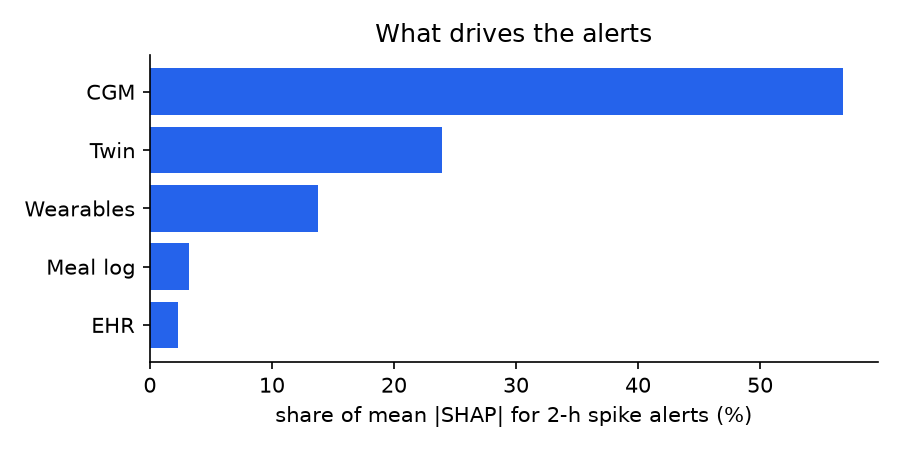

# GlucoTwin: evaluation results

_Auto-generated by `python -m glucotwin.pipeline`. Test set = unseen patients, unseen days._

## Forecast error and spike-alert discrimination

| Model | RMSE / Clarke A+B @30 min | @60 min | @120 min | 2-h spike AUROC |
|---|---|---|---|---|
| Persistence | 22.0 / 99.5% | 37.6 / 97.4% | 53.9 / 94.2% | n/a |
| Linear extrapolation | 23.1 / 99.9% | 50.4 / 95.2% | 94.4 / 80.4% | n/a |
| Twin only (physiology) | 17.6 / 99.6% | 24.2 / 99.1% | 37.5 / 95.9% | n/a |
| CGM only | 12.9 / 100.0% | 21.9 / 99.5% | 27.0 / 99.1% | 0.947 |
| + Wearables & meal log | 9.9 / 100.0% | 18.3 / 99.7% | 25.9 / 99.3% | 0.958 |
| + EHR (stream fusion) | 9.8 / 100.0% | 18.1 / 99.6% | 25.9 / 99.3% | 0.956 |
| + Twin physiology (full hybrid) | 9.1 / 100.0% | 17.2 / 99.7% | 25.0 / 99.4% | 0.959 |

## Final hybrid twin

| Horizon | RMSE | MAE | MARD | Clarke A | Clarke A+B | 90% interval coverage | mean width |
|---|---|---|---|---|---|---|---|
| 30 min | 9.1 | 6.6 | 4.5% | 99.1% | 100.0% | 90.0% | 27 mg/dL |
| 60 min | 17.5 | 11.1 | 7.5% | 91.9% | 99.7% | 88.9% | 43 mg/dL |
| 120 min | 25.2 | 16.3 | 10.7% | 84.8% | 99.4% | 88.1% | 62 mg/dL |

**2-hour hyperglycaemia alert:** AUROC 0.959, AUPRC 0.883, precision 0.89, recall 0.63 at threshold 0.77.

**Event level:** 129/162 excursions above 180 mg/dL flagged in advance (80%), median lead time **70 min**, 0.62 false alerts per patient-day.

## Twin fidelity (parameter recovery against hidden ground truth)

- Spearman ρ basal glucose: 0.87
- Spearman ρ insulin-action gain: 0.90
- Spearman ρ gut absorption speed: 0.77
- Personal calibration reduces twin forecast loss by 21% vs EHR-only prior

## Share of alert explanations by data stream

- CGM: 57%
- Twin: 24%
- Wearables: 14%
- Meal log: 3%
- EHR: 2%

